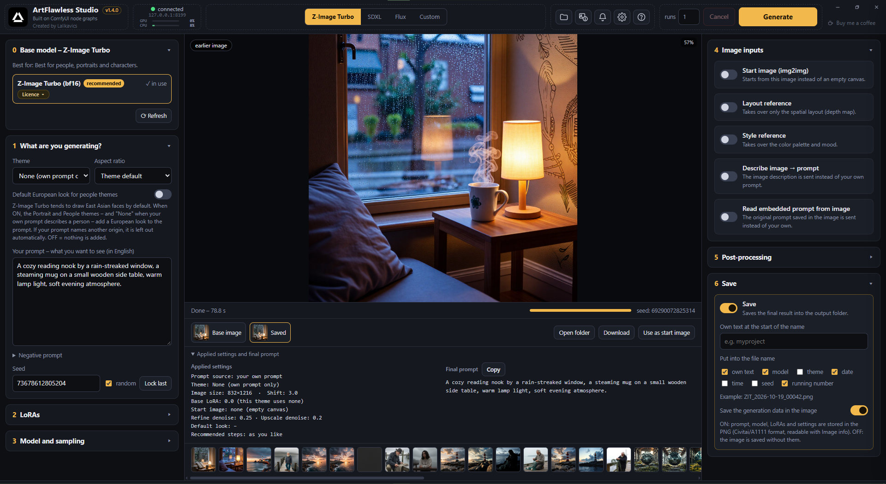

# ArtFlawless Studio

**Local AI image generation, made simple.**



ArtFlawless Studio is a free, open-source Windows application for creating images with AI on your own computer. It consists of
a setup that installs everything you need, and a simple, friendly interface (the *Studio*) on top of
[ComfyUI](https://github.com/comfyanonymous/ComfyUI), the popular node-based image-generation engine.

ComfyUI is very powerful, but its node graphs can be overwhelming for beginners. The Studio hides that complexity: you choose a
model family and a theme, write what you want to see, and press **Generate**. Behind the scenes a carefully wired ComfyUI workflow
builds the image, refines it, fixes faces, hands and feet, and upscales the result. You can still open the full node graph in ComfyUI
at any time if you want to learn how it works or tweak it yourself.

Everything runs locally: no account, no subscription, no cloud service. Your prompts and images never leave your computer, and the
models are downloaded once from their original sources.

*Magyarul: lásd [OLVASSEL.md](OLVASSEL.md).*

## Features

- One setup installs ComfyUI, the needed add-ons and the AI models from their original sources.
- Three model families with ready-made themes: **Z-Image Turbo**, **SDXL** (Juggernaut XL, RealVisXL, Pony) and **Flux.1 schnell**, plus a **CUSTOM** tab for your own models.
- **CUSTOM tab**: recognises the type of the chosen file (SD 1.5, SDXL, Pony, Illustrious, Z-Image, Flux schnell / dev; complete checkpoints,
  diffusion-only models and GGUF files), loads the matching text encoder and VAE, and shows detailed settings for that type, remembered per model.
  It warns when a model is too large for the graphics card or the memory. LoRA rows show whether the LoRA fits the loaded model,
  its trigger words (one click puts them into the prompt) and a separate text-encoder strength.
- Live GPU and CPU load in the header, and an estimated time for each run from the earlier ones.
- Refine, face / hand / foot fix and final upscale steps, image inputs (start image, style reference, image description).
- Civitai-compatible metadata, Image info window, saved workflows, learning mode with hints (English and Hungarian).
- **Hungarian prompting** (Hungarian interface): write the prompt and the negative prompt in Hungarian; a local translator
  (downloaded once, about 470 MB, runs offline) turns them into English, and you can correct the English text by hand before generating.
- "Open a copy in ComfyUI" shows the full node graph, for those who want to look under the hood.

## System requirements

| | Minimum | Recommended |
|---|---|---|
| Windows | 10 64-bit (1803 or newer) or 11 | 11, or 10 22H2 |
| Graphics card | NVIDIA GeForce RTX with 8 GB video memory, up-to-date driver | NVIDIA RTX with 12 GB or more |
| Memory | 32 GB RAM | 64 GB RAM |
| Processor | 4 cores, 64-bit | 6 or more cores |
| Disk | 50 GB free (SSD) | 100 GB free on an NVMe SSD |
| Other | Microsoft Edge (part of Windows), internet connection for the setup | |

Tested on an RTX 3060 Ti 8 GB with 64 GB RAM under Windows 10 22H2. AMD and Intel graphics cards are not supported.

## Download and install

1. Download `ArtFlawlessStudio-Setup-X.Y.Z.exe` from the [Releases](../../releases) page.
2. Run it. The setup downloads about 25 GB, so this takes a while; it can be re-run to resume.
3. Start **ArtFlawless Studio** from the desktop shortcut.

## Updating

Download the new setup from the [Releases](../../releases) page and run it. It finds the existing installation, asks whether to update it
and installs into the same folder. Your images (`input` and `output` folders), saved workflows, downloaded models and settings are kept.
Close the Studio before updating.

## Known limitations

- The layout reference (ControlNet) is available for Z-Image Turbo only.
- SDXL and Flux have no automatic skin / hand LoRAs; the face, hand and foot fix steps work with every family.
- Flux.1 schnell tends to render skin a little "plastic"; for people Z-Image Turbo or RealVisXL work better.
- The setup is not digitally signed yet, so Windows SmartScreen may show a warning ("More info" → "Run anyway").

## Build from source

You need [Python 3](https://www.python.org/downloads/) and [Inno Setup 6.3+](https://jrsoftware.org/isdl.php). Then run:

```
build.bat
```

The setup appears in the `Output` folder. `build.bat` runs `make_studio_files.py` and `make_families.py` (they generate
`studio_out/`) and then compiles `ArtFlawlessStudio.iss`.

GitHub also builds the setup automatically for every change (Actions tab → latest run → *Artifacts*).

## Releasing a new version

1. Change the number in the `VERSION` file (for example `1.3.0` → `1.3.1`). This is the only place where the version is set;
   the setup, the Studio and the About window all read it from there.
2. Add a section for the new version at the top of `CHANGELOG.md`.
3. Commit and push.
4. On GitHub: **Releases → Draft a new release**, tag `v1.3.1` (the same number with a `v`), title `ArtFlawless Studio 1.3.1`, **Publish**.
   The workflow builds the setup and attaches it to the release, with the notes from `CHANGELOG.md`.

Version numbers follow [Semantic Versioning](https://semver.org): fixes raise the last number (1.2.**1**), new features the middle one
(1.**3**.0), changes that break saved workflows or settings the first one (**2**.0.0).

## Project layout

| Path | What it is |
|---|---|
| `VERSION` | the version number (single source) |
| `ArtFlawlessStudio.iss` | Inno Setup script of the Windows setup |
| `build.bat` | builds the setup locally |
| `launcher/` | PowerShell installer and launcher, the frameless window (`ArtFlawlessHost.cs`, compiled on the user's computer) |
| `studio/` | the original Z-Image workflow and the Studio page |
| `make_studio_files.py`, `make_families.py`, `help_texts.py` | generate the Studio page and the SDXL / Flux / Custom templates into `studio_out/` |
| `assets/` | ComfyUI add-on of the Studio (`studio_init.py`), model catalogue, setup texts, icon and logo |
| `tools/` | helper scripts for the release workflow |
| `tools/mt/` | how the Hungarian→English prompt translator was made: data preparation, fine-tuning, evaluation sets, image tests |

## Age requirement and content protection

ArtFlawless Studio may only be used by **adults (18 years or older)**. The setup asks you to confirm this.

- **Content filter**: every image is checked on your own computer (NudeNet detector and Falconsai classifier, on the processor).
  Images recognised as adult content (nudity, sexual content) are blurred, with an eye button to show them, and saved into `output\18+`.
  On by default; it can be switched off in Settings after confirming that you are 18 or older.
- **Safe mode**: adds "no nudity" words to the negative prompt, so nudity does not appear by accident. Z-Image Turbo and Flux.1 schnell
  run without a negative prompt (CFG 1), so for these, when the prompt is about people, safe mode adds "clothed" to the prompt itself. On by default, can be switched off.
- **18+ confirmation**: a prompt that asks for nudity or sexual content needs a one-time confirmation that you are an adult.
- **Child protection**: a prompt that refers to a minor together with nudity or sexual content is always refused, and this cannot be
  switched off. Sexual depictions of minors are illegal, including artificial and AI-generated ones ([EU Directive 2011/93/EU](https://eur-lex.europa.eu/eli/dir/2011/93/oj)).
- **AI marking**: generated PNG images carry a machine-readable "AI-generated" mark (IPTC DigitalSourceType in XMP), in the spirit of
  Article 50 of the [EU AI Act, Regulation (EU) 2024/1689](https://eur-lex.europa.eu/eli/reg/2024/1689/oj).

The recognition is automatic and not perfect: it can miss content or flag harmless images. The AI models are not made or distributed
by the author of ArtFlawless Studio: the setup downloads them from their original sources, and each of them is subject to its own
licence. ArtFlawless Studio tries to reduce the risk of misuse, but as open-source software it cannot rule it out completely. Anyone who
gets around these protections, or changes the program to do so, does it at their own responsibility; the author does not consent to
this and accepts no liability for it.

## Support

ArtFlawless Studio is free and stays free: no paid version, no locked features, no priority for supporters. If you enjoy it, you can
[buy me a coffee](https://buymeacoffee.com/lalikavics) as a voluntary thank-you. It never changes anything in the program.

## Licence

ArtFlawless Studio is free software: you can redistribute it and/or modify it under the terms of the
**GNU General Public License version 3 or (at your option) any later version**. See [LICENSE](LICENSE).

Copyright (C) 2026 Lalikavics.

This program is distributed in the hope that it will be useful, but WITHOUT ANY WARRANTY; without even the implied warranty of
MERCHANTABILITY or FITNESS FOR A PARTICULAR PURPOSE. See the GNU General Public License for more details.

### Third-party components

This repository contains only the ArtFlawless Studio code. ComfyUI, the custom nodes and the AI models are **not** included: the setup
downloads them from their original sources, and each of them stays under its own licence:

- [ComfyUI](https://github.com/comfyanonymous/ComfyUI) (GPL-3.0), installed unmodified.
- Custom nodes: rgthree-comfy, ComfyUI Impact Pack and Subpack, Ultimate SD Upscale, ComfyUI-Florence2, ComfyUI-Custom-Scripts,
  ControlNet Auxiliary Preprocessors, ComfyUI Image Saver, ComfyUI-Prompt-Manager, [ComfyUI-GGUF](https://github.com/city96/ComfyUI-GGUF) (Apache-2.0).
- Flux text encoders for the CUSTOM tab, downloaded only when needed (asks first): CLIP-L (MIT) and T5-XXL fp8 (Apache-2.0)
  from [comfyanonymous/flux_text_encoders](https://huggingface.co/comfyanonymous/flux_text_encoders).
- Content check: [NudeNet](https://github.com/notAI-tech/NudeNet) (the package states both AGPL-3.0 and MIT) and
  [Falconsai/nsfw_image_detection](https://huggingface.co/Falconsai/nsfw_image_detection) (Apache-2.0).
- Prompt translator: ArtFlawless HU→EN v1, fine-tuned from [Helsinki-NLP/opus-mt-tc-big-hu-en](https://huggingface.co/Helsinki-NLP/opus-mt-tc-big-hu-en)
  (CC-BY 4.0, OPUS-MT, University of Helsinki); the fine-tuned model is CC-BY 4.0 too and is downloaded from this repository's
  `translator-v1` release or from [Hugging Face](https://huggingface.co/Lalikavics/artflawless-hu-en-v1).
- Models: Z-Image Turbo and Flux.1 schnell (Apache-2.0), Juggernaut XL v9 (CreativeML Open RAIL-M), RealVisXL V5.0 (OpenRAIL++),
  Pony Diffusion V6 XL (Fair AI Public License 1.0-SD), and the LoRAs, detectors and upscalers listed in the setup.

What you may do with the generated images is set by the licence of each model and LoRA you used. Please read them, especially before
commercial use. The Studio shows a **Licence** button with a link next to every model.

ArtFlawless Studio is an independent project. It is not affiliated with, endorsed by or connected to Comfy Org or the ComfyUI developers.

## Disclaimer

The software is provided "as is", without warranty of any kind. You alone are responsible for what you create with it and how you use
it, including the licences of the models and the laws that apply to you. Do not use it to depict real people without their consent or
to create unlawful or harmful content.

## Contact

Questions, ideas and bug reports: please use [Issues](../../issues) on this page.
If you are the author of a model, LoRA or node used by the setup and want it removed or credited differently, open an issue too.

---

*Developed with the help of Claude (Anthropic).*
